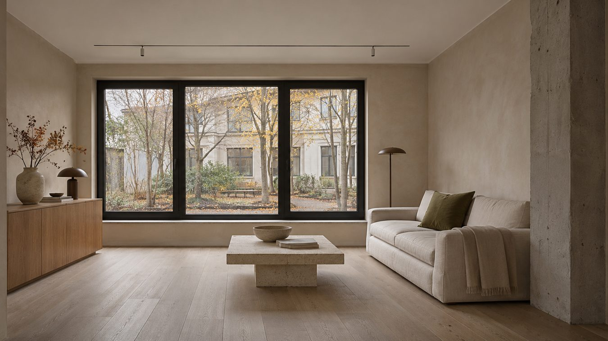

# Мерка

Одностраничный демосайт студии дизайна интерьеров и ремонта под ключ в Москве и области. Посетитель может изучить проекты, прикинуть бюджет ремонта и пройти сценарий записи на консультацию.

**[Открыть сайт на GitHub Pages](https://robdiezz.github.io/merka/)**

[Калькулятор](https://robdiezz.github.io/merka/#calculator) · [Портфолио](https://robdiezz.github.io/merka/#works) · [До и после](https://robdiezz.github.io/merka/#comparison) · [Консультация](https://robdiezz.github.io/merka/#consult)

## Что есть на сайте

- **Интерактивный чертёж.** Девять помещений с площадями, габаритами и деталями планировки. Можно выбрать комнату на чертеже или по номеру, а также скрыть размерные линии.
- **Стили и портфолио.** Пять интерьерных стилей и шесть проектов с фильтрами. Параметры стиля или проекта можно перенести в калькулятор.
- **Сравнение до и после.** Два кадра одной комнаты в одинаковом ракурсе с ползунком, которым можно управлять мышью, касанием или клавиатурой.
- **Калькулятор ремонта.** Площадь от 20 до 400 м², уровень отделки, дизайн-проект, услуги и инженерные опции. Результат показывает бюджет с диапазоном ±10%, стоимость за м², разбивку расходов и график работ. Сметы в портфолио рассчитываются по той же формуле.
- **Демонстрационная запись.** Форма проверяет поля, предлагает свободные слоты по московскому времени и показывает номер заявки и время встречи.
- **Адаптивная вёрстка.** Светлая и тёмная темы следуют настройкам устройства. Сайт поддерживает клавиатуру и системную настройку уменьшения движения.

## Локальный запуск

1. На странице репозитория нажмите **Code → Download ZIP** и распакуйте архив.
2. Откройте `index.html` в браузере. Папка `photos/` должна лежать рядом с ним.

Весь код находится в одном HTML-файле. Стили, скрипты и шрифты встроены, изображения хранятся в `photos/`. Для локального запуска достаточно браузера. Публичная версия размещена на GitHub Pages.

## О демоверсии

Студия, портфолио, отзывы, контакты и реквизиты вымышлены. Изображения сгенерированы, расчёт стоимости ориентировочный. Форма не отправляет и не сохраняет заявки на сервере.
